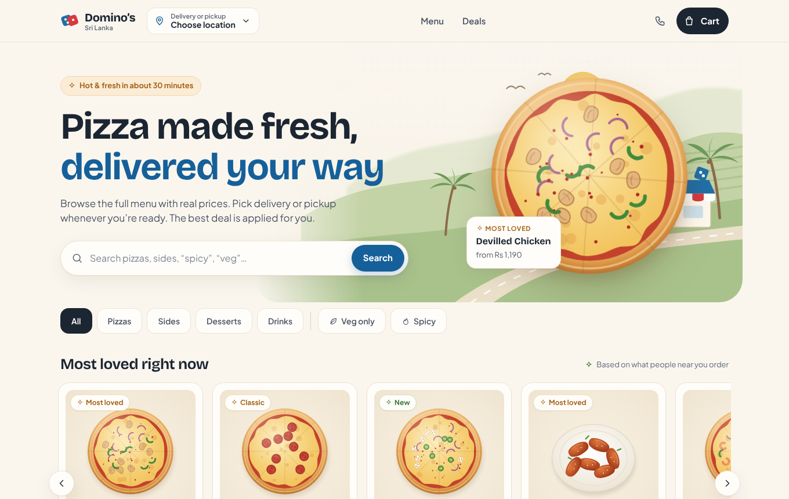
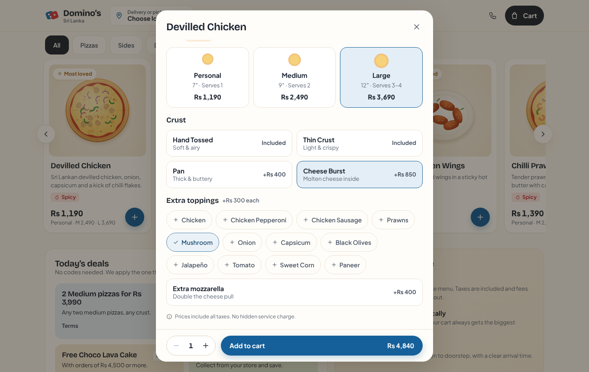
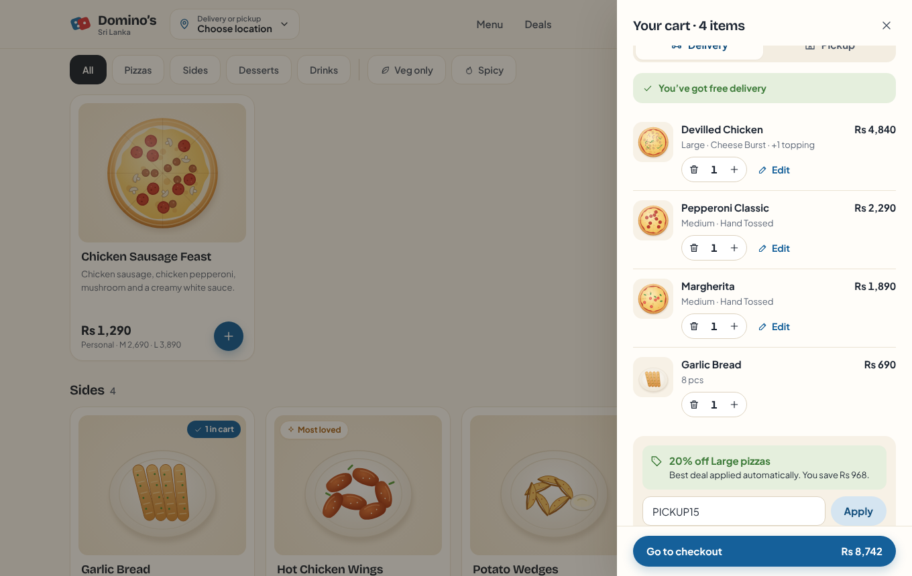
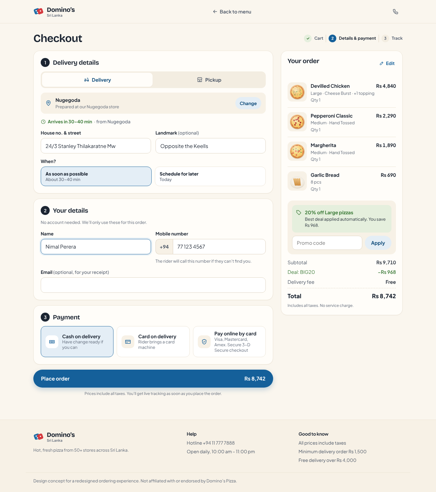
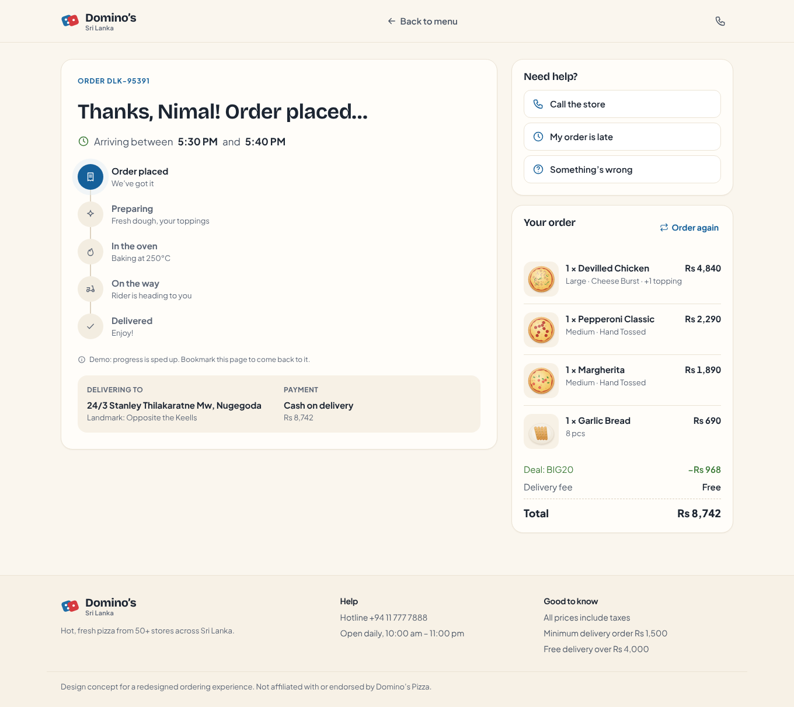
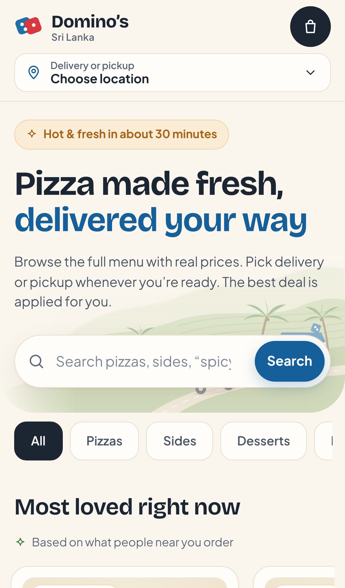

# Domino’s Sri Lanka: ordering redesign (concept)

A clean, warm redesign of the Domino’s Sri Lanka online ordering site. The look takes its cue from soft, illustrated marketplace designs: cream backgrounds, rounded cards and hand-drawn food art. The flow is rebuilt around the most common UX problems with pizza-ordering sites.

> Design concept only. Not affiliated with or endorsed by Domino’s Pizza. Menu items, prices, stores and the hotline number are placeholders.



| Customise | Cart | Checkout |
| --- | --- | --- |
|  |  |  |

| Tracking | Mobile |
| --- | --- |
|  |  |

## Run it

```bash
npm install
npm run dev      # http://localhost:5173
npm test         # pricing, deals and phone-number rules
npm run build
```

## UX issues fixed

| Common issue | What this design does |
| --- | --- |
| Store/address prompt blocks the menu | Browse, see prices and build a cart before choosing a location. The location pill in the header changes it any time. |
| Location permission asked on load | Only asked when you tap “Use my current location”. If it’s denied, you pick your area from a list. |
| Switching delivery/pickup empties the cart | The cart is kept. A toast confirms the switch and the delivery fee updates. |
| Weak Sri Lankan address entry | Area search across stores, a house/street field and an optional **landmark** field (“Opposite the Keells, blue gate”). |
| “From Rs X” hides real prices | Every card lists Personal, Medium and Large prices. The customiser shows the total updating live as you choose. |
| Long multi-step customisation | One sheet for size, crust, toppings, cheese and quantity. Choices are kept if you close it by accident. |
| No add-to-cart feedback | A toast with **Undo** and **View cart**, an “in cart” badge on the card and the cart total in the header. |
| Hard to edit cart items | **Edit** reopens the customiser for that line. Quantity steppers, and removing an item can be undone. |
| Coupon hunting, vague errors | The best deal is applied automatically. Codes give specific reasons (“Add 1 more Medium pizza…”). Nudges only appear when they’d beat your current saving. |
| Fees revealed at the end | Delivery fee, minimum-order progress, free-delivery progress and “prices include taxes” are all shown in the cart. |
| Long, confusing checkout | Guest checkout on one page in three numbered sections. A fixed **+94** prefix accepts any common number format. Errors appear inline and clear as you fix them. |
| Unclear payment outcome | Cash, card on delivery or online. The online option explains that a failed payment won’t charge you and the cart stays saved. |
| Vague order tracking | A clear arrival window, step-by-step tracker, one-tap help (call, late, wrong item) and **Order again**. |
| Auto-sliding carousels | No autoplay. The rail scrolls by swipe or arrow buttons. |
| Category bar disappears on scroll | Sticky category chips plus **Veg only** and **Spicy** filters, and live search with a helpful empty state. |
| Lost cart offline | The cart is saved in the browser, with an offline banner and readable hash URLs (`#/checkout`, `#/order/DLK-12345`). |
| Accessibility gaps | 44px+ tap targets, readable contrast, labelled icon buttons, focus-trapped dialogs that close with Esc, a skip link and reduced-motion support. |

## Structure

```
src/
  data/        menu, sizes, crusts, stores (placeholder data)
  lib/         pricing + deals, phone parsing, hash router
  state/       cart/location/orders store (saved in localStorage), UI state
  art/         SVG food illustrations and hero scene (no image files)
  components/  header, home, customiser, cart, checkout, tracking, dialogs
```

Built with React, TypeScript and Vite. Fonts are self-hosted (Plus Jakarta Sans, Bricolage Grotesque).
