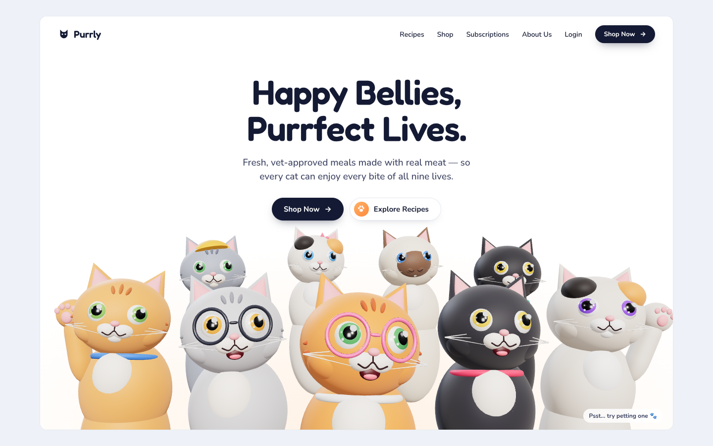

# Purrly — cat food hero



A landing-page hero for a cat food brand: a crowd of animated-movie-style cats
squeezing together for a selfie under the headline.

- The cats rise in on load and gently breathe
- The picture tilts softly toward your cursor
- Click ("pet") the cats to squish them and send up hearts
- Responsive: on phones the crowd bleeds past the edges so the middle cats stay big
- Respects `prefers-reduced-motion`

## Run it

```bash
npm install
npm run dev      # http://localhost:5173
npm run build    # production build in dist/
```

## Where things live

| File | What it does |
| --- | --- |
| `index.html` | Nav, headline, buttons and the cat artwork |
| `public/hero-cats.webp` | The cat crowd render (white background, 16:9) |
| `src/style.css` | Layout, buttons, mobile menu, tilt/breathe/heart animations |
| `src/hero-art.js` | Cursor tilt and click-to-pet hearts |

To swap the artwork, replace `public/hero-cats.webp` with any 16:9 image on a
white background; the white is blended away so the card's warm glow shows through.
